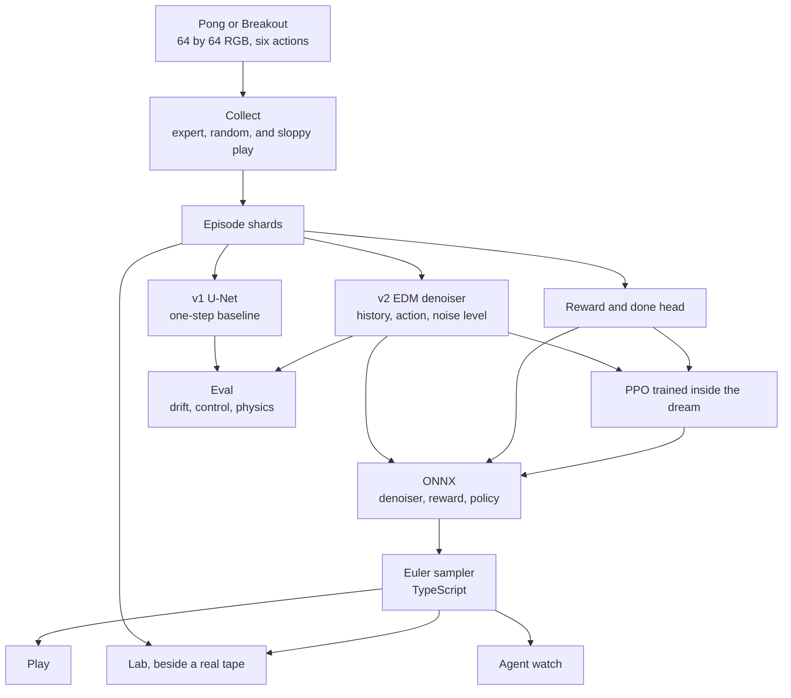

# Dream Arcade

[](https://github.com/namanraii/dream-arcade/actions/workflows/ci.yml)
[](https://www.python.org/downloads/release/python-3110/)
[](LICENSE)

Play Pong, generated one frame at a time by an action-conditioned diffusion model, in the browser.

Dream Arcade learns a world model of a 64×64 table game. At play time the network sees the last four frames and your action, and a few Euler steps denoise the next frame. A separate head predicts the reward and whether the point is over. A PPO agent can be trained entirely inside that dream, then scored on the real game.

Pong is the default. Breakout uses the same pipeline. The weights currently in `web/public/models` are a smoke checkpoint, so the page runs after a clone. They are not a trained result. Measured numbers belong in [`RESULTS.md`](RESULTS.md), which stays empty until `dreamarcade eval` writes them.

## Quick start

Play the smoke checkpoint:

```bash
git clone https://github.com/namanraii/dream-arcade.git
cd dream-arcade/web
npm install
npm run dev
```

Open http://127.0.0.1:5174. Choose Pong or Breakout under the title.

| Mode | What you get |
|---|---|
| Play | Your keys drive the dream. Up and down for Pong. Left and right for Breakout. Space serves. |
| Lab | A recorded game beside the dream, with drift, step count, history length, and re-ground. |
| Agent | The exported policy picks the action. |

Train a real model on a GPU, then replace the smoke weights:

```bash
python3.11 -m venv .venv && source .venv/bin/activate
pip install -U pip && pip install -e ".[dev,metrics]"

dreamarcade collect
dreamarcade train-v2
dreamarcade train-reward
dreamarcade export
```

`notebooks/kaggle_train.ipynb` is the same job on Kaggle or Colab. See [Training](#training).

## Architecture

The real game is used to record training tapes and to draw the lab's reference frames. The browser never steps the game. It steps the denoiser.



The ONNX graph contains the preconditioned denoiser. The Euler schedule stays in TypeScript, so the step slider does not need a new export. WebGPU is tried first, then WASM.

A training sample looks like this:

| Tensor | Shape | Range |
|---|---|---|
| History | `[B, 12, 64, 64]` | [-1, 1], four RGB frames, oldest first |
| Action | int64 | 0..5 |
| Target | `[B, 3, 64, 64]` | [-1, 1] |

Denoiser inputs are `history`, `action`, `noisy_frame`, and `sigma`. The output is `denoised`.

The formulation follows Karras et al. (EDM, 2022) and the action-conditioned world-model setup of Alonso et al. (DIAMOND, 2024). The design note is [`docs/design-note.md`](docs/design-note.md). The full U-Net is about 6.1 million parameters, near 12 MB in fp16.

## Games

Both games are original implementations in this repository. They share a 64×64 RGB observation and six actions. No Atari ROM is required, and none is shipped.

| | Pong | Breakout |
|---|---|---|
| Actions | `NOOP, FIRE, UP, DOWN, UPFIRE, DOWNFIRE` | `NOOP, FIRE, RIGHT, LEFT, RIGHTFIRE, LEFTFIRE` |
| Action 2 | Paddle up | Paddle right |
| Config | `data=pong` | `data=breakout` |
| Browser weights | `web/public/models/` | `web/public/models/breakout/` |

`data=atari_pong` collects `ALE/Pong-v5` after `pip install -e ".[atari]"`. Those frames stay on the machine that recorded them.

## Commands

Run these from the repo root. Anything after the command is a Hydra override.

```bash
dreamarcade collect                 # about 100k frames
dreamarcade collect --config collect_v1   # about 300k frames
dreamarcade train-expert
dreamarcade collect expert_path=outputs/expert/expert.pt

dreamarcade train-v1
dreamarcade train-v2                # resume=outputs/v2/latest.pt
dreamarcade train-reward
dreamarcade eval
dreamarcade export
dreamarcade parity
dreamarcade ppo
dreamarcade distill
dreamarcade play
dreamarcade smoke                   # CPU proof of the whole pipeline
```

Each episode is one of three policies: 40% expert (ε = 0.1), 30% random, 30% sloppy expert (ε = 0.4). With no expert checkpoint, the expert is a scripted ball tracker, and `stats.json` says so.

Checkpoints are `outputs/<run>/latest.pt` and include the EMA weights used by eval and export. `save_every` is 200 steps.

## Training

On a GPU workstation the commands above are enough. `device=cuda` turns on mixed precision. v2 is 100k steps at batch 64.

On Kaggle, open `notebooks/kaggle_train.ipynb`, attach a T4, and keep checkpoints under `/kaggle/working`. A session ends at 12 hours. Resume with:

```bash
dreamarcade train-v2 resume=/kaggle/working/v2/latest.pt device=cuda
```

Colab is the same notebook with paths under `/content`. Download `latest.pt` before the runtime resets. Confirm the current GPU quota on your own account page before a long run.

Bring a finished checkpoint back to the browser:

```bash
dreamarcade export \
  denoiser_checkpoint=outputs/v2/latest.pt \
  reward_checkpoint=outputs/reward/latest.pt \
  out_dir=web/public/models
```

For Breakout, pass `data=breakout` on collect and train, and export into `web/public/models/breakout`.

## Evaluation

`dreamarcade eval` writes `outputs/eval/metrics.json`, `outputs/eval/drift.png`, and fills the generated block in `RESULTS.md`.

| Check | What it reports |
|---|---|
| Drift | PSNR, SSIM, MAE, and LPIPS when the weights download, at horizons 1, 5, 10, 25, 50, 100 |
| Controllability | Whether held up and down move the paddle the same way in the dream and in the game |
| Physics | Ball count, and bounce angle within 20 degrees of the law of reflection |
| Reward | Precision and recall for −1, 0, and +1 |
| Agent | Mean and standard deviation on the real game. Human-normalized score is reported only for ALE Pong |

## Development

```bash
pip install -e ".[dev,metrics,play,track]"
pytest
ruff check src tests

cd web && npm install && npm test
```

CI on GitHub Actions runs Ruff and pytest on Python 3.11. Weights & Biases stays off unless `WANDB_API_KEY` is set and the config has `wandb=true`.

```
configs/                 Hydra configs, one file per command
src/dreamarcade/data/    environments, collector, dataset
src/dreamarcade/models/  U-Net, EDM, baseline, reward head
src/dreamarcade/train/   v1, v2, reward, expert, dream PPO, distillation
src/dreamarcade/eval/    metrics, rollouts, controllability, physics
src/dreamarcade/export/  ONNX export and the parity check
web/                     React arcade
notebooks/               Kaggle training and analysis
docs/                    design note, write-up, model notes
```

## License

[MIT](LICENSE). Copyright Naman Rai.

`github.com/dreamarcade` is an unrelated project. This repository does not redistribute Atari ROMs or Atari frames. See the [model card](MODEL_CARD.md).
