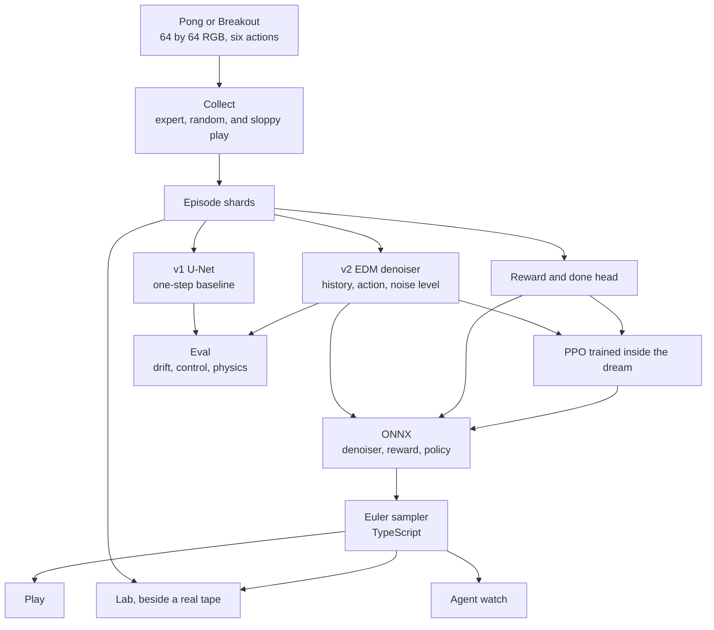

# Dream Arcade

Play Pong inside a neural network. A small action-conditioned diffusion model reads your keypresses and generates the next 64×64 frame. The same model can train a PPO agent that never sees the real game until the evaluation script says so.

The browser runs the denoiser with ONNX Runtime Web (WebGPU, then WASM). The Euler sampler is ordinary TypeScript, so the number of denoising steps is a slider, not a baked-in constant.

This repository is the full system from the plan: data, a one-step baseline, an EDM diffusion model, a reward and termination head, evaluation, dream PPO, ONNX export, and the arcade UI. Training a model that actually stays coherent for 100 steps is a Kaggle job. The numbers in `RESULTS.md` stay empty until that job writes them.

## Architecture

Real games only produce the training tape and the lab's reference frames. Play generates the next 64×64 frame from the last four frames and the action. The ONNX file is the denoiser. The Euler steps stay in the browser, so the step slider does not need a new export.



## What is implemented

| Piece | Command | What "done" means here |
|---|---|---|
| Data engine | `dreamarcade collect` | Sharded episodes, train/val/test by episode, contact and score oversampling, stats report |
| Baseline v1 | `dreamarcade train-v1` | U-Net, weighted L1, optional LPIPS, context noise, scheduled sampling, EMA, resume |
| Diffusion v2 | `dreamarcade train-v2` | EDM preconditioning, log-normal noise, Euler sampler, EMA |
| Reward / done | `dreamarcade train-reward` | 3-way reward plus a done bit, class-balanced sampling, precision and recall in eval |
| Evaluation | `dreamarcade eval` | PSNR, SSIM, LPIPS when weights load, drift curves, controllability, physics, `RESULTS.md` |
| Local play | `dreamarcade play` | Keyboard dream. Writes a gif if no window can open |
| Browser | `cd web && npm run dev` | Pong or Breakout. Play, lab, agent watch, touch buttons |
| ONNX | `dreamarcade export` then `dreamarcade parity` | Denoiser, reward head, policy. fp32 parity is a test |
| Dream PPO | `dreamarcade ppo` | PPO inside the world model, then real-env mean and std |
| Expert for data | `dreamarcade train-expert` | Short PPO on the real env. Used as the 40% expert policy if the file exists |
| Distillation | `dreamarcade distill` | One-step student, prints speedup and the L1 gap |
| Breakout | `data=breakout` | Same pipeline, bottom paddle, horizontal actions. `dreamarcade smoke data=breakout` fills the browser switch |
| Smoke | `dreamarcade smoke` | A few CPU steps of every stage and a browser model. Not a result |

## Layout

```
configs/                 Hydra configs, one file per command
src/dreamarcade/data/    envs, collector, dataset, detectors
src/dreamarcade/models/  U-Net, EDM, baseline, reward head
src/dreamarcade/train/   v1, v2, reward, expert, dream PPO, distillation
src/dreamarcade/eval/    metrics, rollouts, controllability, physics
src/dreamarcade/export/  ONNX and the parity check
web/                     React + TypeScript arcade
notebooks/               Kaggle training, analysis
docs/                    design note, write-up, launch checklist
```

## Setup

Python 3.11. From the repo root:

```bash
python3.11 -m venv .venv
source .venv/bin/activate
pip install -U pip
pip install -e ".[dev,metrics,play,track]"
```

Atari, only if you want the ALE environment:

```bash
pip install -e ".[atari]"
```

Weights & Biases stays off unless `WANDB_API_KEY` is set and the config has `wandb=true`.

Original Pong is the default environment. It has the same 64×64 RGB observation and the same six actions as ALE Pong (`NOOP, FIRE, UP, DOWN, UPFIRE, DOWNFIRE`). Action 2 moves the right paddle up. Nothing in `data/` is an Atari ROM or an Atari frame. `data=atari_pong` switches collection to `ALE/Pong-v5` with frameskip 4. Those frames are not uploaded with this repo.

The Stable-Baselines3 zoo agent `sb3/ppo-PongNoFrameskip-v4` is on the Hugging Face Hub (checked November 2026). It was trained on stacked 84×84 grayscale, so this code does not apply it to 64×64 RGB frames. `dreamarcade train-expert` is the replacement: a small PPO on this environment. Point `expert_path` at `outputs/expert/expert.pt` when you collect.

## Commands

Run these from the repo root. Extra arguments are Hydra overrides.

```bash
# Pipeline test, about 100k frames (400 episodes x 256 steps).
dreamarcade collect

# Training set, about 300k frames.
dreamarcade collect --config collect_v1

# Atari, after ale-py imports cleanly on that machine.
dreamarcade collect data=atari_pong out_dir=data/atari-pong

dreamarcade train-expert
dreamarcade collect expert_path=outputs/expert/expert.pt

dreamarcade train-v1
dreamarcade train-v2          # resume=outputs/v2/latest.pt to continue
dreamarcade train-reward
dreamarcade eval
dreamarcade play
dreamarcade export
dreamarcade parity
dreamarcade ppo
dreamarcade distill

# Proves every stage on CPU. Writes web/public/models and web/public/replays.
dreamarcade smoke
```

Policy mix while collecting, chosen per episode: 40% expert with ε=0.1, 30% uniform, 30% sloppy expert with ε=0.4. Without an expert checkpoint the expert is a scripted ball tracker, and `stats.json` says so.

Checkpoints land in `outputs/<run>/latest.pt` and include the EMA. Export and eval load the EMA. `save_every` defaults to 200 steps so a preempted Kaggle session can resume. Bump it down if a step is slow.

Expected shapes on a training sample:

| Tensor | Shape | Range |
|---|---|---|
| history | `[B, 12, 64, 64]` | [-1, 1], four RGB frames, oldest first |
| action | int64 | 0..5 |
| target | `[B, 3, 64, 64]` | [-1, 1] |

Denoiser ONNX inputs are `history`, `action` (int64 `[1]`), `noisy_frame`, `sigma`. The output is `denoised`. Preconditioning is inside the graph. The sampler is not.

## Browser

```bash
cd web
npm install
npm test
npm run dev    # http://127.0.0.1:5174
```

`dreamarcade smoke` or `dreamarcade export` must have written `web/public/models/denoiser.onnx` first. The page says so if the file is missing. It does not invent frames.

Play: arrow up, arrow down, space to serve. On a phone, the up and down buttons send the same actions. Lab: real episode beside the dream, MAE drift (not LPIPS), denoising steps, history length, sampling noise, history noise, a drift meter, and re-ground. Agent: argmax of `policy.onnx`.

## Kaggle

`notebooks/kaggle_train.ipynb` is the training entry. Checked public write-ups as of November 2026, which you should confirm on your own account page before a long run:

- GPU quota is about 30 hours a week, sometimes higher, shared across GPUs, and it resets weekly.
- A GPU session is documented at up to 12 hours. Idle timeouts are shorter. Keep a run under 9 hours.
- The current accelerator option in recent write-ups is T4×2 (16 GB each). One source says the P100 option was retired on 15 September 2026. If your account still shows a P100, either card is fine; this code uses one GPU.
- Colab free is the overflow. Its GPU quota is not published. Sessions are capped at 12 hours.

Checkpoint files in `/kaggle/working` survive a save. Anything else on the session disk does not. Copy `latest.pt` out before the session ends.

A full v2 config is 100k steps, batch 64, mixed precision on CUDA. The U-Net is sized to stay under the 30 MB fp16 budget (`tests/test_shapes.py` checks the parameter count). If a step is too slow on a T4, drop `model.base_channels` before you spend the week.

## Evaluation

`dreamarcade eval` writes `outputs/eval/metrics.json`, `outputs/eval/drift.png`, and replaces the generated block in `RESULTS.md`.

Drift horizons are 1, 5, 10, 25, 50, 100. LPIPS is included when the `lpips` package can download AlexNet weights. Otherwise the table has PSNR, SSIM, and MAE, and the report says LPIPS was skipped.

Controllability holds action 2 and action 3 from the same start in the real env and in the dream, and compares the sign of paddle motion. Physics counts balls and checks wall and paddle bounces against the law of reflection within 20 degrees. Both metrics are easy to game with a blurry model that still has a bright blob, so read them next to the frames.

Reward precision and recall are per class. Class 0 is reward −1, class 1 is 0, class 2 is +1.

PPO reports real-environment mean and standard deviation. Human-normalized score is computed only for `ALE/Pong-v5`, with random −20.7 and human 14.6. Original Pong does not use those constants.

## Tests

```bash
pytest
ruff check src tests
```

The ONNX test trains one tiny step and checks PyTorch against ONNX Runtime. CI does the same on CPU.

## Naming and license

Code is MIT. See `LICENSE`.

This code lives at `github.com/namanraii/dream-arcade`. `github.com/dreamarcade` is an unrelated Web3 organization. The Hugging Face Hub has unrelated arcade models and datasets. Do not publish Atari ROMs or raw Atari frames. The model card states that limitation.

## Honest limits

A smoke checkpoint will not play like Pong. Diffusion world models in the papers were trained for days on a large GPU. This project trains a smaller U-Net, on Pong only, for a student GPU budget, and the write-up in `docs/write-up.md` is where the gap belongs. Drift, ignored actions, and a vanishing ball are the expected failure modes. The lab exists so those are visible.
